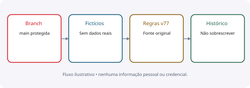
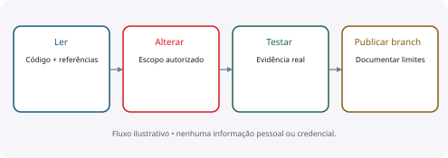

# Agent Instructions

Como trabalhar no sistema sem perder regras e histórico

**IBAGY DP · 13/10/2026 · edição 1.0 · pré-produção**

Guia operacional da branch de migração. O arquivo AGENTS.md na raiz contém as instruções executáveis para agentes; este documento explica o fluxo com linguagem visual.

Este documento descreve o sistema e seus limites; não autoriza merge em main ou produção.

## 01 · Regras obrigatórias

Trabalhar em migracao-vercel-supabase. Não alterar main nesta tarefa; não liberar produção enquanto críticos estiverem incompletos. As instruções explícitas do usuário têm prioridade sobre este guia.
Usar apenas dados fictícios em testes, capturas e documentos. Não expor senhas, tokens de acesso, cookies, backups ou chaves Supabase. Não resetar conta existente nem banco sem autorização específica.

| Regra | Aplicação prática |
| --- | --- |
| Preservar v77 | Conferir fonte original antes de alterar fórmula |
| Preservar competências | Nunca sobrescrever meses anteriores por conveniência |
| Concluir com evidência | Informar testes executados e seus limites |
| Não apagar por aparência | Verificar imports, scripts, build, migrations e licenças |
| Não contornar bloqueios | Explicar erro real e pedir só informação necessária |
| Conflitos | Comparar revisão/HEAD e atualizar a base antes de repetir |

## 02 · Fluxo de trabalho

Começar por git status, branch e documentação; localizar o caminho afetado. Fazer mudanças pequenas, coerentes e revisáveis. Alterações reversíveis e commits na branch de migração já autorizados não exigem nova confirmação a cada passo.
Usar rg para referências. Ler o código chamador e os módulos de domínio; conferir dependências de build e imports dinâmicos. Se precisar remover algo, registrar caminho, motivo e testes.

| Etapa | Saída esperada |
| --- | --- |
| 1 · Identificar | Escopo, branch, estado do trabalho |
| 2 · Verificar | Referências e regra original |
| 3 · Implementar | Mudança focada, sem segredo |
| 4 · Testar | Caso relevante + regressões necessárias |
| 5 · Publicar branch | Commit com resultado e limitação |
| 6 · Conferir preview | Build e fluxo afetado |
| 7 · Documentar | Estado implementado versus validado |

> Se o conector/GitHub for usado, criar árvore sobre o HEAD atual e atualizar ref com expected_sha, sem force.

> Se a solicitação expirar após uma escrita, consultar o estado antes de repetir; não presumir sucesso nem falha.

## 03 · Testes e verificação

Rodar os testes proporcionais à mudança. Para fórmula, comparar o motor original e casos extremos. Para persistência, conferir POST → recarga → banco, bloqueios, revisão e auditoria. Testes SQL devem usar fixtures fictícias e rollback.
Não confundir teste HTTP com transporte simulado e teste real do deployment. Não afirmar que todos os campos foram validados pela interface quando a evidência cobre apenas alguns fluxos.

| Área | Comandos em package.json |
| --- | --- |
| Motor e dados | test:migration; test:fields |
| Arquivos | test:files; test:health-export |
| Comissão/DSR | test:record-actions; test:commissions; test:dsr-city |
| Cadastro | test:employee-edit |
| Integrações prioritárias | test:priority-actions |
| Acesso | test:security |
| Build Vercel | build:vercel; conferir READY do commit correto |

> Não criar testes que apenas repetem uma alteração visual simples. Validar import/build e o fluxo quando houver efeito funcional.

> Ao acabar testes temporários, remover contas/sessões/arquivos da fixture e confirmar a limpeza. Não tocar contas reais.

## 04 · Organização e entrega

Fonte ativa: app/, components/ui/, lib/, proxy.ts, configurações e package/lock. Evidência: scripts/, supabase/tests/, tools/ui-tests/, docs/. Referência legada: build/, drizzle/, db/ e módulos Cloudflare ainda chamados.
Manter PRD, Design System, Architecture e Agent Instructions consistentes com o código. Diagramas são ilustrativos, não capturas de pessoas reais. Não colocar detalhes de implementação desnecessários nos fluxos do produto.

| Entregar | Critério |
| --- | --- |
| Código | Somente a branch autorizada; nenhum segredo |
| Teste | Resultado real, inclusive falhas e bloqueios |
| Documentos | Links funcionando, data/escopo e fonte de verdade |
| Limpeza | Relatório dos itens removidos e preservados |
| Risco | Pendências que impedem merge/produção |
| Comunicação | Atualizações curtas e concretas durante o trabalho |

> No final, dizer o que mudou, por quê, como foi verificado e o que ainda falta.

> Não declarar a migração concluída nem recomendar produção prematuramente.

