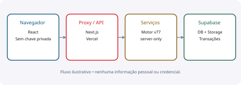
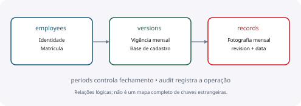
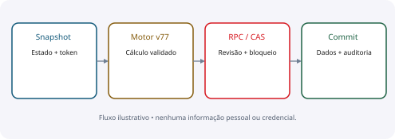

# Architecture

Camadas, dados, integrações e operação

**IBAGY DP · 13/10/2026 · edição 1.0 · pré-produção**

A arquitetura alvo é Next.js na Vercel com PostgreSQL e Storage no Supabase. O caminho legado Cloudflare permanece referenciado durante a migração e não foi removido como código sem função.

Este documento descreve o sistema e seus limites; não autoriza merge em main ou produção.

## 01 · Visão do sistema

Browser → proxy Next → handlers /api → serviços server-only → Supabase REST/RPC/Storage. O navegador nunca recebe a chave service_role. Autenticação de equipe da Vercel é diferente da autenticação de usuário do IBAGY DP.
Rotas: /api/auth gerencia contas/sessões; /api/finance lê e grava o financeiro; /api/documents recebe anexos; /api/migration-health é diagnóstico restrito a administrador.

| Camada | Fonte | Responsabilidade |
| --- | --- | --- |
| Interface | app/*.tsx; components/ui | Rascunhos, apresentação, navegação |
| Borda/API | proxy.ts; app/api | Origem, métodos, limites e respostas |
| Domínio | lib/finance-service.ts e regras | Motor v77, validações e cálculos |
| Integração | lib/supabase-*.ts | Servidor exclusivo, snapshot e RPC |
| Persistência | supabase/*.sql | Transações, revisões e auditoria |
| Arquivos | Supabase Storage privado | Upload, versões e download autenticado |

## 02 · Modelo de dados

O banco tem 23 tabelas de aplicação com RLS ativo. Os dados financeiros continuam no formato do modelo v77; records.data e versions.data carregam payload JSON em texto. Isso exige validação de domínio e não equivale a esquema totalmente normalizado.
Valores de tabelas de referência usam centavos inteiros; payloads financeiros usam decimais em string conforme o código original. Evitar reimplementar arredondamentos.

| Grupo | Tabelas |
| --- | --- |
| Contas (4) | app_users, app_sessions, app_login_attempts, administrators |
| Núcleo (5) | employees, versions, records, periods, audit |
| Configuração (9) | allowances, minimum_wages, normative_wages, dsr_settings, dsr_city_settings, job_functions, unimed_rates, uniodonto_fixed_rates, uniodonto_rates |
| Eventos/arquivos (5) | childcare_children, event_plans, loans, installments, files |

> employees identifica o cadastro; versions registra a vigência; records guarda a fotografia mensal com revision. Não misturar uma edição atual da base com o histórico de um mês anterior.

> Tabelas legadas e migrações não devem ser apagadas sem análise de dados, consumidores e plano de reversão.

## 03 · Escrita, segurança e concorrência

Escrita financeira: validar origem e conta, verificar perfil, obter snapshot/token, executar cálculo original, chamar RPC, conferir revisão e gravar mudanças/auditoria na transação. Um token de snapshot é controle de alteração, não autenticação.
Sessões usam tokens aleatórios; somente hashes SHA-256 ficam no banco. Senhas usam PBKDF2-SHA256 com salt por conta. Criação da sessão confere hash esperado e conta ativa na transação; limita cinco sessões. Mudança administrativa revoga sessões e audita em operação atômica.

| Proteção | Estado verificado |
| --- | --- |
| RLS e privilégios | 23 tabelas; sem concessões públicas diretas |
| RPCs | Nenhuma função public executável por anon/authenticated |
| Storage | Bucket privado; download autenticado, attachment/nosniff |
| Auditoria | service_role insere/consulta; não altera/exclui/trunca |
| API | Origem, limites, corpo validado e erros sanitizados |
| Histórico | CAS/revisão e bloqueios de períodos/commission |
| Perfis | Servidor autoriza; esconder menu não é controle de acesso |

> RLS não limita service_role nem o proprietário do banco. A segurança depende das verificações de servidor e da proteção dos segredos.

> GET não deve recalcular ou sincronizar silenciosamente a folha.

## 04 · Build, operação e limites

Vercel usa vercel.json → npm run build:vercel → next build. A seleção process.env.VERCEL direciona handlers para o caminho Supabase. Scripts dev/build/start genéricos continuam associados a Sites/Cloudflare; não assumir equivalência.
SQLs em supabase/ representam fases e substituições de funções. Eles não formam, ainda, um bootstrap único comprovado para instalação nova. Executar todos os arquivos por nome pode restaurar função antiga; aplicar a ordem revisada, especialmente DSR padrão e security-hardening.

| Ponto de operação | Ação necessária |
| --- | --- |
| Segredos | Configurar apenas no servidor; não imprimir ou commitar |
| Deploy protegido | Usar link temporário ou identidade Vercel autorizada |
| Rollback | Preparar plano de código + schema + dados; não usar reset |
| Backup | Testar restauração isolada de banco e anexos |
| Dependências | Preservar lock/política; verificar alertas atualizados |
| Validação | Separar código/mock, PostgreSQL real e interface |
| Produção | Bloqueada enquanto houver críticos incompletos |

> Pendências: matriz HTTP real/cabeçalhos, dependências e carga; fluxo de troca obrigatória de senha; restauração/operabilidade; parte da validação funcional de interface.

> Veja docs/security-validation-2026-10-13.md. Build/teste aprovado não autoriza merge em main.

## Quitação antecipada SEREFI

`lib/supabase-loan-settlement.ts` usa snapshots por competência e o motor v77 para recalcular os registros afetados. RPCs em `supabase/finance-loan-settlement.sql` validam token, revisões e competências, e persistem quitação, cronograma original, cobranças zeradas e auditoria na mesma transação. Somente `service_role` pode executar; API exige administrador e mesma origem. O arquivo privado do reinício reversível permanece intocado.
