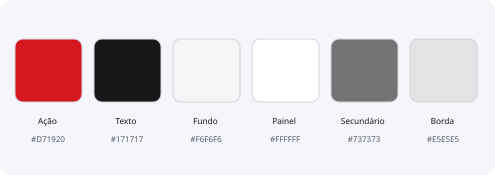
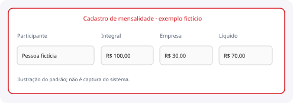

# Design System

Identidade, padrões de interface e acessibilidade

**IBAGY DP · 13/10/2026 · edição 1.0 · pré-produção**

Um guia do visual existente, com recomendações explícitas onde a validação ainda falta. A limpeza não redesenha o produto nem substitui componentes ativos.

Este documento descreve o sistema e seus limites; não autoriza merge em main ou produção.

## 01 · Identidade e linguagem visual

Identidade IBAGY: vermelho como ação principal, superfícies claras e conteúdo de trabalho organizado em painéis. A cor deve reforçar o significado, acompanhada de texto ou ícone.
Tipografia da aplicação: Arial/Helvetica/sans-serif. Título principal em torno de 25–29 px; títulos de seção 18–20 px; campos e texto 14–16 px. A documentação visual usa Open Sans para boa leitura em PDF.

| Token observado | Valor | Uso |
| --- | --- | --- |
| --primary | #D71920 | Ação principal e foco |
| --foreground | #171717 | Texto principal |
| --background | #F6F6F6 | Fundo geral |
| --card | #FFFFFF | Painéis |
| --muted-foreground | #737373 | Texto secundário do tema |
| --border | #E5E5E5 | Bordas |
| --radius | 0.625rem | Raio base (10 px) |

> Fonte de verdade: app/globals.css. Existem estilos históricos com cinzas diferentes dos tokens; não assumir que todos passam no contraste.

> O logo existente em public/ibagy-logo.png e o favicon real foram preservados.

## 02 · Componentes em uso

Componentes ativos ficam em components/ui: button, checkbox, dialog, input, select, separator, sheet, sidebar, skeleton, table, tabs, textarea e tooltip. A base atual usa Radix UI e Tailwind; não depende dos templates removidos.
Painéis, barras de competência, resumo e tabelas são composições próprias em app/. A tabela extensa mantém rolagem própria; a navegação lateral permanece independente.

| Componente/padrão | Aplicação | Comportamento |
| --- | --- | --- |
| Button | Salvar, incluir, gerar, fechar | Desabilitar durante operação; texto claro |
| Input/Select | Cadastro e valores | Rótulo visível; formato e erro junto ao campo |
| Dialog/Sheet | Edição e navegação móvel | Foco controlado; fechar acessível |
| Table | Folha e participantes | Cabeçalhos claros; números legíveis |
| Tabs | Áreas e subáreas | Estado selecionado compreensível |
| Sidebar | Navegação do sistema | Administração somente para admin |
| Toast + alerta | Resultado da operação | Sucesso/erro sem depender só de cor |

## 03 · Fluxos e estados

Uma ação de salvar precisa distinguir editado, salvando, salvo e erro. Manter o conteúdo preenchido quando a operação falhar; não anunciar conclusão antes da resposta do servidor.
Comissões têm um botão único para as linhas alteradas. DSR mostra qual calendário está sendo usado. Plano de saúde coloca os campos do participante na mesma linha quando houver largura suficiente e reorganiza em telas menores.

| Estado | Texto/ação | Regra |
| --- | --- | --- |
| Carregando | Carregando dados… | Não permitir gravação de uma competência incompleta |
| Em lançamento | Competência aberta | Editar somente se o servidor autorizar |
| Fechada | Consulta disponível | Reabertura exige motivo |
| Sem cálculo | Atualizar valores automáticos | Exportação deve bloquear valores incompletos |
| Conflito | Atualize antes de salvar | Não sobrescrever revisão de outro operador |
| Erro | Mensagem acionável | Preservar rascunho, sem expor detalhes internos |
| Vazio | Próxima ação sugerida | Explicar inclusão/cadastro sem culpar o usuário |

> “Atualizar dados” recarrega a tela; “Atualizar valores automáticos” calcula e salva. Os dois rótulos não são equivalentes.

> Os exemplos ilustrados não são capturas de dados reais.

## 04 · Acessibilidade e telas menores

Meta de aceitação: operação por teclado, foco visível, rótulos e mensagens compreensíveis; contraste WCAG AA (4,5:1 para texto normal, 3:1 para texto grande). São metas, não certificação atual.
No celular, controles de toque devem ter alvo de pelo menos 44 px. A largura da página não deve ser imposta pela folha; tabelas rolam no próprio contêiner. Colunas de saúde refluem em telas estreitas.

| Verificar | Aceite |
| --- | --- |
| Teclado | Navegar, editar, confirmar e fechar sem mouse |
| Setas na folha | Rolar horizontalmente sem interceptar edição de campos |
| Foco | Indicador visível e ordem lógica |
| Erros | Texto junto ao campo e anúncio assistivo |
| Contraste | Medir textos e estados, inclusive cinzas históricos |
| Zoom 200% | Sem perda de controles ou rótulos |
| Responsividade | Conferir celular, tablet e desktop largo |
| Administração | Item final acessível por rolagem da barra lateral |

> Não cortar valores financeiros para fazer caber. Usar formatação pt-BR e preservar o valor numérico de origem.

> Evitar expor nomes/valores reais em capturas e documentos de teste.

## Conferência e quitação SEREFI

Na Conferência da Folha, alternar colunas sem preenchimento e rosa pastel `#fce7ef`, iniciando sem cor; aplicar a mesma sequência aos cabeçalhos, células e ações. O diálogo de quitação informa pagamento fora da folha, data, referência opcional, prévia do saldo e confirmação separada.
