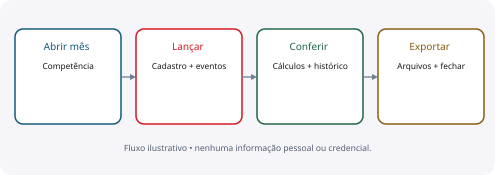
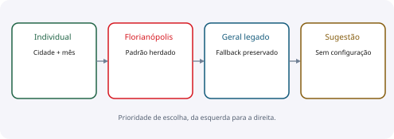

# PRD

Produto, requisitos e critérios de aceite

**IBAGY DP · 13/10/2026 · edição 1.0 · pré-produção**

O IBAGY DP organiza lançamentos, benefícios e conferência da folha por competência. A migração precisa preservar a experiência da versão 77, seus cálculos e o histórico mensal.

Este documento descreve o sistema e seus limites; não autoriza merge em main ou produção.

## 01 · Produto e pessoas

Objetivo: permitir que o DP cadastre, calcule, confira e envie dados à contabilidade em Vercel + Supabase, com evidência de persistência e proteção do histórico.
Administrador opera os lançamentos, configurações e permissões. Consulta acompanha dados autorizados, sem gravar alterações. A contabilidade recebe arquivos; não existe portal externo da contabilidade comprovado.

| Papel | Necessidade | Critério de aceite |
| --- | --- | --- |
| Administrador | Operar e corrigir o mês | Permissões conferidas no servidor |
| Consulta | Conferir informações | Escritas recusadas, não apenas escondidas |
| DP | Preservar o passado | Mudança atual não sobrescreve meses anteriores |
| Contabilidade | Receber dados consistentes | Arquivo contém os valores calculados da competência |

> O foco é o sistema existente. Redesigner a interface ou alterar regras financeiras não faz parte da limpeza.

> Dados de exemplo desta documentação são fictícios. Nenhuma credencial é publicada.

## 02 · Requisitos funcionais

A situação “implementado” descreve código e integração. “Validado” exige especificar se a evidência vem de teste local, banco real ou interface.

| ID | Requisito | Aceite essencial |
| --- | --- | --- |
| RF01 | Abrir e incluir na competência | Motor v77 completo, sem duplicação |
| RF02 | Editar cadastro e lançamentos | Vigência e revisão; histórico preservado |
| RF03 | Conferir folha/custos/provisões | Resultados automáticos persistem ao recarregar |
| RF04 | Comissões | Um botão salva as linhas alteradas; DSR/IR consistentes |
| RF05 | DSR por cidade | Florianópolis padrão; cadastro individual tem prioridade |
| RF06 | Unimed e Uniodonto | Participantes, mensalidades e coparticipação por mês |
| RF07 | Auxílio-creche | Elegibilidade e limite calculados pela regra original |
| RF08 | SEREFI e eventos parcelados | Parcelas automáticas sem aplicação duplicada |
| RF09 | Dissídio/reajustes e rescisões | Prévia, confirmação e transação consistente |
| RF10 | Exportações | Comissão, saúde e folha; versões privadas e baixáveis |
| RF11 | Fechar/reabrir | Bloqueio de edição; motivo e auditoria na reabertura |
| RF12 | Segurança | Login, perfis, limites, auditoria e revogação de sessões |

## 03 · Histórico e regras de negócio

Cada competência é independente. Cadastro possui versões por vigência; lançamentos mensais possuem revisão. Uma edição deve respeitar os meses anteriores e fechados.
DSR: usar o calendário individual da cidade, se existir no mês. Caso contrário usar Florianópolis; depois o calendário geral legado; por último a sugestão automática. Não criar cópias individuais que impeçam herdar mudanças do padrão.

| Agência | Cidade aplicada |
| --- | --- |
| Biguaçu | Biguaçu |
| Kobrasol | São José |
| Palhoça | Palhoça |
| Demais agências | Florianópolis |

> A fórmula e o arredondamento devem continuar os da versão 77. A documentação não cria regra trabalhista nova.

> Exportação de saúde usa o maior número de dependentes de cada plano na competência. Cada dependente recebe nome, mensalidade e serviço/coparticipação. Acima do limite de 256 colunas do XLS, usar XLSX.

## 04 · Validação e decisão de lançamento

Código financeiro integrado e testes existentes passaram; isso não equivale a migração pronta. Login/logout e apresentação de perfis foram conferidos na interface com contas fictícias. A matriz HTTP real, cabeçalhos, dependências e carga ainda precisam de validação completa.

| Portão | Evidência exigida |
| --- | --- |
| Cálculos | Paridade v77 e casos de admissão, benefícios e rescisão |
| Persistência | Salvar → recarregar → conferir no banco |
| Histórico | Comparação de meses anteriores e fechados |
| Contabilidade | Abrir os três arquivos e conferir valores e dependentes |
| Acesso | Admin/consulta/anônimo; APIs e arquivos privados |
| Concorrência | Edição antiga recusada; nenhuma gravação parcial |
| Operação | Backup e restauração, configuração e rollback testados |
| Merge/produção | Revisão explícita, build válido e críticos completos |

> Prioridade P0: cálculos, histórico, autorização e exportações. P1: concluir a validação de benefícios e eventos. P2: ajustes de ergonomia sem regressão.

> A main permanece protegida. Este documento não autoriza merge ou publicação em produção.

## Quitação antecipada SEREFI

Pagamento externo à folha, mediante prévia do saldo e confirmação com data e referência opcional. Preservar o contrato e cronograma original; zerar apenas cobranças da competência escolhida em diante e recalcular folhas abertas pelo motor v77. Bloquear parcelas em meses fechados e conflitos com rescisões. Auditoria e rejeição de gravações concorrentes/repetidas obrigatórias.
